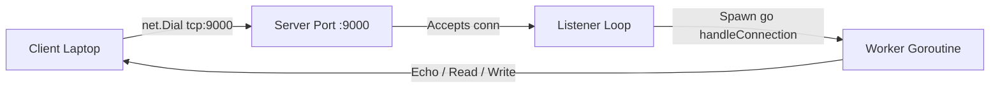
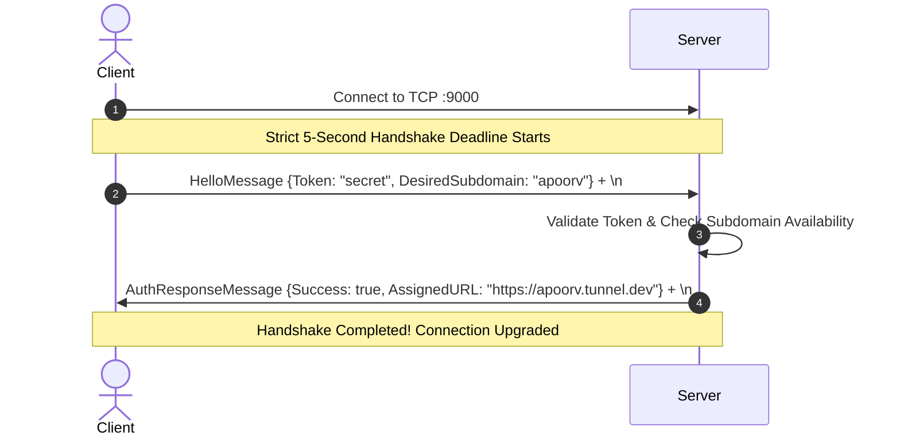
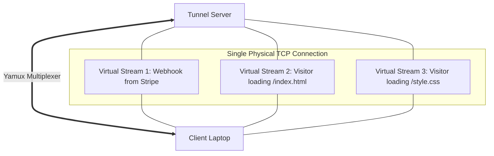
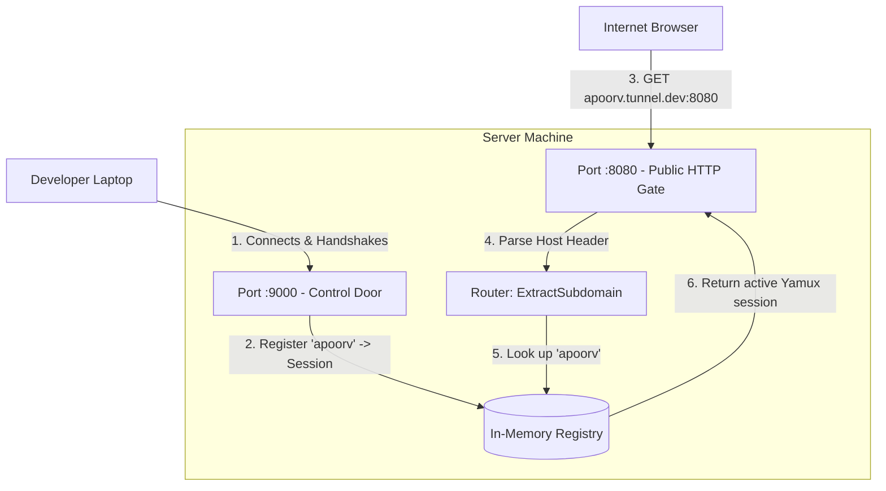
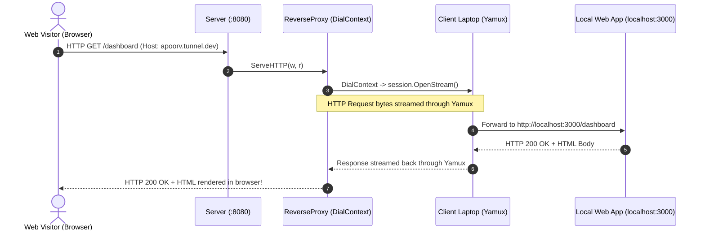

# 🚀 Go-Ngrok: Days 1 to 5 Complete Guide & Explanation

Welcome to the comprehensive, beginner-friendly guide for the **Tunnel (Go-Ngrok)** reverse proxy project! This document walks through **Days 1 to 5 step-by-step**, explaining the core concept in plain English, with architecture flowcharts, structs, tools, and commented code snippets.

---

## 📑 Table of Contents
1. [Day 1: TCP Foundations & Connection Plumbing](#day-1-tcp-foundations--connection-plumbing)
2. [Day 2: Protocol Framing, Generic Codec & Handshake Auth](#day-2-protocol-framing-generic-codec--handshake-auth)
3. [Day 3: Connection Multiplexing with Yamux](#day-3-connection-multiplexing-with-yamux)
4. [Day 4: In-Memory Tunnel Registry, Virtual Host Router & Two-Listener Architecture](#day-4-in-memory-tunnel-registry-virtual-host-router--two-listener-architecture)
5. [Day 5: HTTP Reverse Proxy Over Multiplexed Streams](#day-5-http-reverse-proxy-over-multiplexed-streams)

---

# Day 1: TCP Foundations & Connection Plumbing

### 1. Layman Explanation (What We Did & Why)
Imagine you are building a walkie-talkie connection between two houses:
- **Server (Public Cloud Machine):** A house with an open phone line waiting for callers.
- **Client (Your Local Laptop):** You picking up the phone and dialing the server's number (`localhost:9000`).

In Day 1, our goal was to lay down the raw communication pipe.
Before doing any fancy tunneling, we needed:
1. A server that binds to a port and waits for incoming connections (`net.Listen`).
2. A client that dials into the server (`net.Dial`).
3. The ability for multiple clients to connect concurrently without blocking each other (Goroutines!).
4. A **graceful shutdown** mechanism so that when the server stops (e.g. `Ctrl+C`), it doesn't abruptly sever existing calls without giving them a moment to finish.

---

### 2. Flowchart


---

### 3. Key Concepts, Tools & Structs

| Tool / Struct | Package | Why We Used It |
| :--- | :--- | :--- |
| `net.Listener` | standard `net` | Sits on a TCP port and waits for incoming network connections via `.Accept()`. |
| `net.Conn` | standard `net` | Represents an established, active bi-directional TCP pipe between client and server. |
| `sync.WaitGroup` | standard `sync` | Tracks active client connections (`Add(1)`, `Done()`, `Wait()`) so the server waits for them during shutdown. |
| `context.Context` | standard `context` | Listens for the OS interrupt signal (`os.Interrupt` / `Ctrl+C`) to notify the server when to stop accepting new clients. |
| `slog` | standard `log/slog` | Modern, high-performance structured logging in Go (prints clean key-value log entries). |

---

### 4. Simplified Code Walkthrough

#### Server Accept Loop & Graceful Shutdown:
```go
// 1. Bind to TCP port 9000
listener, err := net.Listen("tcp", ":9000")
if err != nil {
    log.Fatal(err)
}
defer listener.Close()

// 2. Loop forever to accept incoming client connections
for {
    conn, err := listener.Accept() // Blocks until a client dials in
    if err != nil {
        break // Triggered if listener was closed during shutdown
    }

    // 3. Spawns an independent goroutine for each client!
    // This allows 1,000+ clients to connect at the same time.
    go func(c net.Conn) {
        defer c.Close()
        // Handle client communication here...
    }(conn)
}
```

#### Client Connector:
```go
// Client dials into the server's address
conn, err := net.Dial("tcp", "localhost:9000")
if err != nil {
    log.Fatal("Could not connect to server:", err)
}
defer conn.Close()

fmt.Println("Connected to server successfully!")
```

---

# Day 2: Protocol Framing, Generic Codec & Handshake Auth

### 1. Layman Explanation (What We Did & Why)
Raw TCP has a big catch: **TCP is a stream of bytes, NOT a stream of individual messages.**

Imagine sending two separate sentences through a pipe:
1. `{"message": "Hello"}`
2. `{"message": "World"}`

Because of network chunking and buffering, the server might receive them squished together as:
`{"message": "Hello"}{"message": "World"}`
Or even cut in half:
`{"message": "He` ... and later ... `llo"}`

This problem is called **TCP framing / packet coalescing**. If you pass raw TCP bytes straight to `json.Unmarshal`, it crashes because it does not know where one message ends and the next begins!

**Our Solution:**
1. **Framing with Newline Delimiter (`\n`):** Every JSON message ends with a newline byte (`\n`). When reading, we read byte-by-byte until we see `\n`, then deserialize that single message.
2. **Generics (`[T any]`):** We wrote one generic function `ReadMessage[T](conn)` that can deserialize any struct (`HelloMessage`, `AuthResponseMessage`, etc.) safely without repeating boilerplate.
3. **Handshake Authentication:** The client presents an authentication token and their requested subdomain (e.g. `"apoorv"`). The server verifies the token and responds with success or rejection under a strict 5-second deadline.

---

### 2. Flowchart


---

### 3. Key Concepts, Tools & Structs

#### Structs (`internal/protocol/messages.go`):
```go
// Sent by Client immediately after TCP connection is established
type HelloMessage struct {
    Type             string `json:"type"`              // e.g. "hello"
    Token            string `json:"token"`             // Auth token (e.g. "dev-secret-token")
    DesiredSubdomain string `json:"desired_subdomain"` // Requested subdomain (e.g. "apoorv")
    ClientVersion    string `json:"client_version"`    // e.g. "1.0.0"
    OSPlatform       string `json:"os_platform"`       // "windows", "linux", "darwin"
}

// Sent by Server in response to validate or reject the handshake
type AuthResponseMessage struct {
    Type         string `json:"type"`          // "auth_response"
    Success      bool   `json:"success"`       // true if valid token
    AssignedURL  string `json:"assigned_url"`  // "https://apoorv.tunnel.dev"
    ErrorMessage string `json:"error_message"` // Reason if success == false
}
```

---

### 4. Simplified Code Walkthrough

#### Writing a Framed Message:
```go
func WriteMessage[T any](w io.Writer, msg T) error {
    // 1. Convert struct to JSON bytes
    data, err := json.Marshal(msg)
    if err != nil {
        return err
    }
    // 2. Append '\n' delimiter to mark the end of this message frame
    data = append(data, '\n')
    // 3. Write onto the wire
    _, err = w.Write(data)
    return err
}
```

#### Reading a Framed Message (Generics):
```go
func ReadMessage[T any](r io.Reader) (*T, error) {
    var buf []byte
    singleByte := make([]byte, 1)

    // Read byte-by-byte until we reach the delimiter '\n'
    for {
        _, err := r.Read(singleByte)
        if err != nil {
            return nil, err
        }
        if singleByte[0] == '\n' {
            break // Complete frame found!
        }
        buf = append(buf, singleByte[0])
    }

    // Unmarshal JSON into target struct T
    var msg T
    if err := json.Unmarshal(buf, &msg); err != nil {
        return nil, err
    }
    return &msg, nil
}
```

---

# Day 3: Connection Multiplexing with Yamux

### 1. Layman Explanation (What We Did & Why)
Here is the core reverse-tunneling dilemma:
- A developer runs an ngrok client on their laptop behind a home WiFi router (NAT / Firewall).
- The laptop connects **outbound** to the server once.
- But later, **dozens of web visitors** hit the server at the same time to view the developer's website!

How can the server send 50 different web requests down to the laptop over just **one** established TCP socket without opening new inbound ports on the laptop's router?

**Enter Yamux (Yet Another Multiplexer):**
Yamux takes a single physical TCP connection and turns it into a highway with unlimited lanes!
- The single TCP connection stays open.
- Over that single TCP connection, Yamux can open hundreds of lightweight **virtual streams** (`yamux.Stream`).
- Each virtual stream acts like an independent `net.Conn` (it has its own `Read` and `Write`).
- If one virtual stream pauses or transfers a huge file, it does not block the other streams!
- Keepalive pings (every 15 seconds) keep firewalls from dropping the connection when there are no visitors.

---

### 2. Flowchart


---

### 3. Key Concepts, Tools & Structs

| Tool / Struct | Library | Why We Used It |
| :--- | :--- | :--- |
| `yamux.Session` | `github.com/hashicorp/yamux` | Represents the multiplexed highway session over the physical TCP connection. |
| `yamux.Stream` | `github.com/hashicorp/yamux` | A virtual bidirectional stream running inside the session. Implements Go's standard `net.Conn` interface. |
| `session.OpenStream()` | `yamux` | Called by the **Server** when a new visitor arrives, creating a new virtual channel to the client. |
| `session.AcceptStream()` | `yamux` | Called in a loop by the **Client** to receive incoming virtual channels from the server. |
| `cfg.EnableKeepAlive` | `yamux` | Sends background heartbeat pings so NAT routers don't close idle connections. |

---

### 4. Simplified Code Walkthrough

#### Upgrading Server TCP to Yamux Server Session:
```go
// Wrap the raw TCP conn into a Yamux server session
cfg := yamux.DefaultConfig()
cfg.EnableKeepAlive = true
cfg.KeepAliveInterval = 15 * time.Second

session, err := yamux.Server(conn, cfg)
if err != nil {
    return err
}
// Server can now open virtual streams to this client anytime:
// stream, err := session.OpenStream()
```

#### Upgrading Client TCP to Yamux Client Session:
```go
// Client wraps its side of the TCP conn into a Yamux client session
session, err := yamux.Client(conn, cfg)
if err != nil {
    return err
}

// Client listens for incoming virtual streams opened by the server
for {
    stream, err := session.AcceptStream() // Waits for server to send a visitor request
    if err != nil {
        break // Connection closed
    }

    // Handle each visitor stream in a background goroutine
    go func(s *yamux.Stream) {
        defer s.Close()
        // Read visitor request & write local response...
    }(stream)
}
```

---

# Day 4: In-Memory Tunnel Registry, Virtual Host Router & Two-Listener Architecture

### 1. Layman Explanation (What We Did & Why)
Now our server needs to handle real web traffic from the internet. To do this cleanly, the server needs **TWO separate doors (ports)**:

1. **Port :9000 (Private Control Door):**
   - Developer laptops connect here using their CLI client.
   - They authenticate and leave their Yamux session open.
2. **Port :8080 (Public Front Gate):**
   - Anyone on the internet (visitors, browsers, webhooks) visits this port:
     e.g. `http://apoorv.tunnel.dev:8080/dashboard`

**The Missing Link: How does Port :8080 know which laptop to send the request to?**

We built two essential components:
1. **The Registry (`internal/server/registry`):**
   - A thread-safe in-memory "phonebook" (`sync.RWMutex`).
   - Maps `subdomain -> *Tunnel (with yamux.Session)`.
   - When a client connects on `:9000`, their subdomain is saved. When they disconnect, it is removed.
2. **The Router (`internal/server/router`):**
   - Examines the visitor's HTTP `Host` header: `"apoorv.tunnel.dev:8080"`.
   - Extracts the clean subdomain: `"apoorv"`.
   - Looks up `"apoorv"` in the Registry phonebook. If found, it routes to that client's Yamux session; if not found, it returns `404 Not Found`.

---

### 2. Flowchart


---

### 3. Key Concepts, Tools & Structs

#### Registry Struct (`internal/server/registry/registry.go`):
```go
type Tunnel struct {
    Subdomain  string
    Session    *yamux.Session // Live multiplexed line to client
    ClientAddr string
    CreatedAt  time.Time
}

type Registry struct {
    mu      sync.RWMutex        // Allows multiple concurrent readers, single writer
    tunnels map[string]*Tunnel  // "apoorv" -> Tunnel struct
}
```

#### Why `sync.RWMutex`?
- **Read Lock (`mu.RLock()`):** 10,000 visitors can look up tunnels in the map at the same exact millisecond without waiting for each other.
- **Write Lock (`mu.Lock()`):** Only when a client connects or disconnects is the map temporarily locked for exclusive update.

---

### 4. Simplified Code Walkthrough

#### Router: Subdomain Extraction
```go
func ExtractSubdomain(hostHeader string, rootDomain string) (string, error) {
    // 1. Remove port number if present: "apoorv.tunnel.dev:8080" -> "apoorv.tunnel.dev"
    host, _, err := net.SplitHostPort(hostHeader)
    if err != nil {
        host = hostHeader // No port present
    }

    host = strings.ToLower(host)
    rootDomain = strings.ToLower(rootDomain)

    // 2. Check suffix: must end with ".tunnel.dev"
    suffix := "." + rootDomain
    if !strings.HasSuffix(host, suffix) {
        return "", fmt.Errorf("invalid host domain")
    }

    // 3. Extract prefix: "apoorv"
    subdomain := strings.TrimSuffix(host, suffix)
    if subdomain == "" {
        return "", fmt.Errorf("subdomain cannot be empty")
    }

    return subdomain, nil
}
```

#### Public HTTP Handler Lookup:
```go
mux.HandleFunc("/", func(w http.ResponseWriter, r *http.Request) {
    // Extract "apoorv" from "apoorv.tunnel.dev:8080"
    subdomain, err := router.ExtractSubdomain(r.Host, "tunnel.dev")
    if err != nil {
        http.Error(w, "Invalid host", http.StatusBadRequest)
        return
    }

    // Look up in Registry
    tunnel, ok := reg.Get(subdomain)
    if !ok {
        http.Error(w, "Tunnel not found or offline", http.StatusNotFound)
        return
    }

    // Tunnel found! Route request over Yamux session
    w.WriteHeader(http.StatusOK)
    w.Write([]byte("Tunnel found for " + subdomain))
})
```

---

# Day 5: HTTP Reverse Proxy Over Multiplexed Streams

### 1. Layman Explanation (What We Did & Why)
Now comes the magical moment: **An actual web visitor loads the developer's local website!**

When a visitor opens `http://apoorv.tunnel.dev:8080/api/users`:
1. The server receives the standard HTTP request on port `:8080`.
2. The server looks up Apoorv's `yamux.Session`.
3. The server needs to forward this HTTP request to Apoorv's laptop, wait for the response, and send it back to the visitor.

**How Go's `httputil.ReverseProxy` does this:**
Normally, an HTTP reverse proxy dials an IP address over the internet (`net.Dial("tcp", "target-ip:80")`).
**The Trick:**
We replaced the standard HTTP Transport's `DialContext` function!
Instead of dialing a real internet IP address, our custom `DialContext` calls:
```go
session.OpenStream()
```
This tricks Go's production-grade `ReverseProxy` into piping full HTTP requests and responses straight down the virtual Yamux stream into the developer's laptop!

---

### 2. Flowchart


---

### 3. Key Concepts, Tools & Structs

| Tool / Struct | Package | Why We Used It |
| :--- | :--- | :--- |
| `httputil.ReverseProxy` | `net/http/httputil` | Standard Go reverse proxy engine. Handles HTTP headers, streaming bodies, status codes, and chunked transfer encoding automatically. |
| `http.Transport` | `net/http` | Manages the network transport for HTTP requests. |
| `DialContext` | `http.Transport` | The hook that opens a network connection. Overridden to call `session.OpenStream()` instead of `net.Dial()`. |
| `Director` | `httputil.ReverseProxy` | Rewrites incoming request headers (sets `X-Forwarded-For`, `X-Forwarded-Proto`, and preserves original path/query). |

---

### 4. Simplified Code Walkthrough

#### Creating the Tunnel Reverse Proxy (`internal/server/proxy/proxy.go`):
```go
func NewTunnelProxy(session *yamux.Session) *httputil.ReverseProxy {
    // 1. Custom transport that dials through Yamux instead of the internet!
    transport := &http.Transport{
        DialContext: func(ctx context.Context, network, addr string) (net.Conn, error) {
            // Open a virtual stream to the client laptop
            stream, err := session.OpenStream()
            if err != nil {
                return nil, fmt.Errorf("failed to open yamux stream: %w", err)
            }
            return stream, nil // yamux.Stream satisfies net.Conn!
        },
    }

    // 2. Configure ReverseProxy
    proxy := &httputil.ReverseProxy{
        Director: func(req *http.Request) {
            // Point the request target to HTTP
            req.URL.Scheme = "http"
            req.URL.Host = "tunnel-client"
            
            // Add proxy headers so the backend knows the real visitor info
            req.Header.Set("X-Forwarded-Proto", "http")
        },
        Transport: transport,
    }

    return proxy
}
```

#### Using the Proxy in the Public HTTP Server:
```go
mux.HandleFunc("/", func(w http.ResponseWriter, r *http.Request) {
    // 1. Extract subdomain from host
    subdomain, err := router.ExtractSubdomain(r.Host, rootDomain)
    if err != nil {
        http.Error(w, "Bad Request", http.StatusBadRequest)
        return
    }

    // 2. Look up tunnel in Registry
    tunnel, ok := reg.Get(subdomain)
    if !ok {
        http.Error(w, "Tunnel Not Found", http.StatusNotFound)
        return
    }

    // 3. Create reverse proxy bound to this client's Yamux session
    proxy := proxy.NewTunnelProxy(tunnel.Session)

    // 4. Stream the visitor's request directly to the client laptop!
    proxy.ServeHTTP(w, r)
})
```

---

## 🎯 Summary of Days 1–5 at a Glance

| Day | Big Picture Goal | What Got Solved? |
| :---: | :--- | :--- |
| **Day 1** | **Raw TCP Socket** | Connected Client to Server over a basic TCP socket with graceful shutdown. |
| **Day 2** | **Framing & Handshake** | Fixed TCP message chunking using `\n` framing, built generic JSON codec, authenticated client. |
| **Day 3** | **Multiplexing** | Sliced 1 physical connection into unlimited virtual streams using HashiCorp Yamux. |
| **Day 4** | **Routing & Registry** | Created the two-door server (`:9000` control, `:8080` public), subdomain parser, and thread-safe phonebook. |
| **Day 5** | **HTTP Reverse Proxy** | Hooked Go's `httputil.ReverseProxy` to stream visitor HTTP traffic directly through Yamux into the client laptop! |

---
*Created for the Go-Ngrok Reverse Tunnel Project.*

